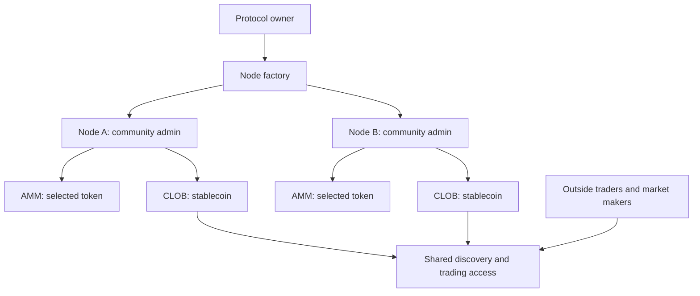

# Sooth Factory

Sooth Factory is a factory-based prediction-market protocol. Independently administered nodes each run a community AMM and a stablecoin order book, connected through shared discovery and trading access.

**Development status:** experimental contracts and local validation tooling. The current revision has no claimed independent external audit. See [STATUS](STATUS.md) for verification and deployment history, [CONTRIBUTING](CONTRIBUTING.md#build-and-verify-locally) to build this repository, and [SECURITY](SECURITY.md) to report a vulnerability.

This repository ships a sample `ManualAdjudicator` with its shared `AdjudicatorBase`. Manual is for demos and tests. Any other adjudicator must implement `IAdjudicator` and satisfy the [resolution and admission requirements](docs/factory-and-authority.md#resolution-and-network-admission).

## The model

The protocol owner deploys the factory and protocol releases. A node operator administers each node and can connect a community token to its AMM markets or use the same supported stablecoin as its CLOB. The operator chooses AMM fee allocation and receives the **OPERATOR** share. The protocol owner chooses CLOB fee allocation and receives the **PROTOCOL** share. These rights remain separate even when both venues use the same token.

The AMM primarily serves sponsor-funded discovery and community participation. The stablecoin CLOB serves commercial, active market makers and traders. Sponsorship buys participation and information; a solvent AMM does not promise the sponsor a positive return. A factory and shared trading access do not themselves supply maker capital.

AMM and CLOB are parallel venues. Both are available from a market's scheduled trading start. There is no trial, graduation, volume qualification, or promotion from a shared node to a dedicated node. A community may operate a node from the outset.

Most markets serve their communities or topic specialists. Shared discovery and trading access expose those same markets to outside traders and market makers as interest grows. Market attention is not a contract state transition.

## Read the design

| Document | Purpose |
| --- | --- |
| [Architecture](docs/architecture.md) | Explanatory map of nodes, venues, settlement, and network access |
| [Permissions and economics](docs/permissions-and-economics.md) | Reading guide to authority and money-flow specifications |
| [Factory and authority](docs/factory-and-authority.md) | Concrete deployment topology, role transfers, and market commitments |
| [Fee accounting and same-token support](docs/fee-accounting-and-same-token.md) | Separate vaults, full allocation, rounding, timeout policies, and claims |
| [Economics and hardening](docs/economics-and-hardening.md) | Critical review, proposed mitigations, interactions, and measurable acceptance |
| [Status](STATUS.md) | Current readiness |
| [Contribution guide](CONTRIBUTING.md) | Build, test and contribution workflow |

## Document authority

Each topic has one authoritative home. Authority here identifies where a rule is maintained.

| Topic | Authoritative home | Boundary |
| --- | --- | --- |
| Deployment, administrative capabilities, market commitments, lifecycle and network admission | [Factory and authority](docs/factory-and-authority.md) | Owns topology, role checks/transfers, creation snapshots and shared truth transitions; refers to the fee specification for monetary entitlements. |
| Fee configuration and accounting | [Fee accounting and same-token support](docs/fee-accounting-and-same-token.md) | Owns schemas, arithmetic, receipts, custody ledgers, rounding, payment eligibility, timeout distribution, surplus. |
| Economic objectives and hardening | [Economics and hardening](docs/economics-and-hardening.md) | Owns sponsor execution protections, growth-policy economics, maker requirements, rationale, interactions, and interactions; refers to factory/fee rules for authority and payments. |
| Current repository progress and readiness | [STATUS](STATUS.md) | Owns current release state. |
| Contribution workflow | [CONTRIBUTING](CONTRIBUTING.md) | Owns proposal/change/validation practice. |

Architecture, permissions and this README summarize or route readers to those homes; they do not add requirements, blocker lists or progress records. If documents disagree, use the owning source, report the discrepancy and repair its references; do not treat the newest prose or a task checklist as an implicit product decision.

Change a rule in its owning document first, then update its acceptance references and affected summaries. Start reading with the three domain specifications.
