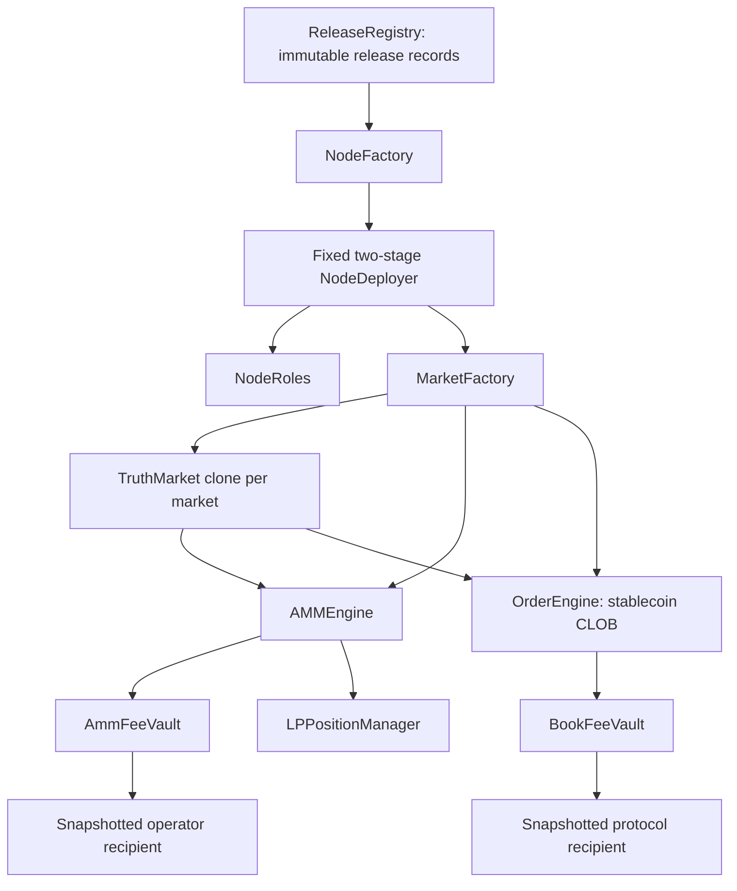

# Factory, authority, and market commitments

**Scope and authority:** this is the canonical specification for deployment topology, administrative capabilities, market creation and immutable terms, truth lifecycle, resolver binding, and network identity/admission/trading-access scope. The [fee specification](fee-accounting-and-same-token.md) owns fee configuration schemas, arithmetic, custody ledgers, payment entitlements, timeout distribution, rounding, and surplus; the [economics specification](economics-and-hardening.md) owns economic objectives, sponsor execution protections, and maker-readiness requirements. See the [document authority map](../README.md#document-authority).

## Topology

Use dedicated engines and fee vaults per node. `AMMEngine`, `OrderEngine`, `AmmFeeVault`, and `BookFeeVault` have four distinct custody addresses; none is shared with another node. This gives node and venue custody clear addresses. A shared matching engine or cross-node margin system is a separate project.

`NodeFactory` deploys complete nodes. Each node’s `MarketFactory` creates individual prediction markets and atomically registers both venues. It has no graduation role. Its interface is `IMarketFactory` and its address field/getter is `marketFactory` throughout the current contracts, SDK, and manifests.

Arrows express dependencies, not administrative control. `NodeRoles` has two independent capabilities; a common reference to it must never become a common superuser. A market's two engines query the same immutable settlement commitment, but have separate positions, collateral, fees, and withdrawal authorization.

## Role contract

`NodeRoles` stores `nodeAdmin`, `pendingNodeAdmin`, `protocolAuthority`, and `pendingProtocolAuthority`. Each incumbent can propose or cancel only its own successor; only the named successor can accept. Reject zero addresses and require a deliberate transaction to change authority. No factory override, generic executor, delegatecall, or shared owner recovery key exists in the first-release proposal.

The factory places the consenting operator directly in `nodeAdmin` and the standing policy's CLOB governor in `protocolAuthority`. Under node creation autonomy, no protocol-side approval or individual operator admission is required. Initial CLOB authority and book economics come exclusively from the registry's policy for the selected stablecoin; an operator cannot substitute itself as governor. That bootstrap policy cannot later override a deployed node's role transfers. A requester acquires only its explicitly assigned role. Replacing a role changes who may publish future configurations; the [fee snapshot and entitlement rules](fee-accounting-and-same-token.md#2-configuration-and-commitments) govern existing money. An inaccessible beneficiary or role key has no undisclosed administrator bypass; operational multisig and rotation procedures remain necessary.

| Capability | Node admin | Node protocol authority | Protocol owner (registry) | Other authorized party |
| --- | --- | --- | --- | --- |
| Publish future AMM rate, split, recipient configuration | Yes | No | No | None |
| Publish future CLOB rate, split, recipient configuration | No | Yes | No inherent node-role power | None |
| Admit or delist stablecoins for node deployment | No | No | Yes | Factory validates support at both stages |
| Publish standing book terms for future nodes | No | No | Yes | Prepared nodes retain their pinned terms |
| Publish or revoke protocol releases | No | No | Yes | Revocation blocks new and pending nodes, not active nodes |
| Change the other role or redirect its venue's surplus | No | No | No | Payment authorization is defined in the [fee specification](fee-accounting-and-same-token.md#1-custody-and-authority) |
| Choose AMM token policy and market creators for future markets | Yes, within technical safety limits | No | No | Authorized creators choose within node policy |
| Choose the node's CLOB stablecoin at deployment | Request a supported asset | No | Admits the supported set | Factory validates the choice |
| Replace collateral committed by an existing market | No | No | No | A new market is required; an AMM default may change for future markets |
| Replace a node's immutable CLOB stablecoin | No | No | No | A new node is required |
| Pause AMM exposure and AMM liquidity additions | Yes, if this proposed control is selected | No | No | Unwind and claims remain open |
| Pause CLOB new exposure | No | Yes, if this proposed control is selected | No inherent node-role power | Cancel, collateral release and settlement remain open |
| Pause future market creation | Yes | No | No | No separate protocol admission veto over either venue |
| Alter an existing question, fee snapshot, resolution profile or outcome | No | No | No | Only declared resolution transitions under the pinned policy |
| Resolve, attest, veto, or finalize | No inherent role power; admits the profile for future markets | No inherent role power | No inherent role power | Resolvers and guardians named by the pinned adjudicator profile; permissionless terminal paths where specified |
| Exercise custody/payment rights | No additional entitlement from role | No additional entitlement from role | No additional entitlement from role | [Fee payment rules](fee-accounting-and-same-token.md#1-custody-and-authority) and entitled-holder engine rules govern claims |

Emergency controls are proposed, not accepted blanket powers. If the CLOB control is included, every fill must reduce or preserve exposure for **both maker and taker** without weakening collateral coverage. An incoming closing order cannot open exposure for a resting maker. Cap each fill at both parties' permissible close amounts; a flip cannot cross through zero. During this mode, refund an incoming unfilled remainder rather than resting a new order, and skip or cancel incompatible resting orders under a specified bounded matching rule. Define the predicates against derived signed exposure (`owned YES - owned NO`), gross ownership, reservations and backing. Net exposure is not an ownership ledger: zero exposure may still contain complete sets. Cancellation, free-collateral withdrawal and terminal claims remain available; executable closing liquidity is not guaranteed.

An AMM pause similarly needs a quote/solvency-tested sell path; do not retain a global pause check that blocks all exits while claiming unwind remains open. If an asset itself is frozen, the protocol cannot guarantee its transfers. The local release omits both optional exposure pauses. The node-admin creation pause affects only future markets; the compatibility `isPaused()` getter is always false.

Under the accepted market-creation autonomy decision, `MarketFactory` has no protocol-controlled admission toggle. Every valid, funded creation registers both venues atomically; the node admin alone controls creation permission and creation pause. Existing nodes do not consult future-deployment eligibility when creating markets. Protocol CLOB fee configuration remains authoritative and is snapshotted at creation. Network listing policy affects discovery and routing; it does not authorize an on-chain creation veto or prevent direct trading. No separate AMM-only creation or delayed book activation is introduced.

## Release and deployment identity

A release record stores the source revision, authenticated manifest hash, TruthMarket implementation/runtime hash and fixed deployer creation hash; child creation recipes are separately pinned. The manifest binds the semantic interface version and keccak256 hash of the exact SDK ABI bundle alongside twelve complete compiler-artifact hashes. Compiler settings, source hashes and constructor/request ABIs are transitively authenticated through those artifacts. The local preimage is `abi.encode(bytes20 sourceRevision, bytes32[12] artifactHashes, string interfaceVersion, bytes32 sdkAbiHash)`. Runtime verification authenticates those inputs before reconstructing each instance's immutable arguments; different node addresses can produce different runtime hashes. Records are append-only. Revoking a release disables new factory creation and pending activation only; existing active contracts, events and user claims continue to exist.

Use `nodeId = keccak256(chainId, factory, requester, userSalt, releaseId)`. This is an identity rule, not a uniqueness requirement per token. `NodeTypes.Request` contains the release, salt, requester, node admin, supported book token, AMM surplus recipient, expiry, expected book-policy version/hash and initial AMM config. There is no operator-chosen AMM fee ceiling; the rate is bounded by 10_000 bps. It contains no book fee, book recipient, book surplus recipient or protocol-authority choice. The chain/factory-bound `SOOTH_FACTORY_NODE_REQUEST_V3` hash commits the complete request. The immutable policy selected by `(bookToken, version)` contains the protocol authority, book surplus recipient, book fee ceiling and initial `BookConfig`; its hash is `keccak256(abi.encode(policy))`. Every publication increments that token's active version, even for identical contents. Beginning a node requires the active version and exact stored hash. Completion requires the committed version to exist (`0 < version <= activeVersion`) and its stored hash to match; later publications neither block completion nor replace its terms. Stablecoin support remains a current admission flag at both stages: delisting blocks completion and relisting resumes it, even if newer policies now exist. The protocol owner's other emergency stop is release revocation. Both controls apply globally to pending nodes using the affected asset or release. The local release has no signed relayer API. Front-running another user's salt cannot substitute administrators or recipients.

The named node admin authorizes the complete request and its AMM bootstrap economics: its own authenticated requester call suffices, otherwise it must approve the exact request on chain, including through a contract wallet. Approval remains revocable until completion and is consumed at activation. The initially designated protocol authority cannot propose, accept or cancel a protocol-role transfer while a factory node is pending: NodeRoles pins its deployer as an immutable activation gate, which opens only after all completion checks succeed. This prevents a selective protocol veto by changing the expected governor between stages. Node-admin transfers remain subject to the initial-consent check; an admin may abandon its own pending deployment. The protocol owner authorizes CLOB economics once by publishing a standing policy; neither it nor the policy's protocol authority signs individual node requests. The factory fills all book-side constructor values from that pinned policy. A stranger cannot label a node as operated by another address, and a stale policy cannot silently change either deployment stage. There is no on-chain denylist for a particular operator; network listing remains separate.

Deployment algorithm selected for the local implementation:

1. `beginNode(request)` validates the release, supported stablecoin, requester, expiry, active policy version/hash and node-admin consent. It also rejects a zero AMM surplus or operator recipient, an AMM rate above 10_000 bps and an AMM allocation that does not sum to 10_000 bps, so a request that fails these checks cannot reserve a node identity. A surplus or operator recipient equal to the predicted AMM engine or vault address passes this stage, and `completeNode` then rejects it. Resolve the complete book policy from the registry; no per-node protocol approval or governor-eligibility check is performed. Reserve the node identity and complete request hash in a pending record; it is not an active node.
2. Deploy a fixed `NodeDeployer` with CREATE2 from the factory/release and committed request. Deploy `NodeRoles` (nonce 1), `OrderEngine` (2) and `AMMEngine` (3), including the AMM-owned LP manager. The protocol role comes from the policy. No market factory or registered market exists yet. Retain any explicit node-admin approval so that admin can revoke before completion.
3. `completeNode(request)` requires the same requester and exact commitment. Recheck node-admin consent, expiry, existence and exact hash of the pinned policy version, release and supported stablecoin. Republished terms do not invalidate a prepared node or change any book constructor argument. Deploy `AmmFeeVault` (nonce 4), `BookFeeVault` (5), and `MarketFactory` (6). Book settings come exclusively from the pinned historical policy; AMM settings come from the request. Initial configurations and surplus recipients follow the [fee configuration](fee-accounting-and-same-token.md#2-configuration-and-commitments) and [surplus](fee-accounting-and-same-token.md#7-donations-rounding-reserves-and-surplus) rules. All references use the original predicted addresses.
4. Each stage marks its state before external calls and can succeed only once. Constructors initialize the committed configuration; there is no external initialization window or generic executor. An LP manager created by the AMM consumes the AMM's nonce, not the NodeDeployer's.
5. Verify runtime, immutable links, request-selected admin/AMM terms, pinned-policy protocol authority/book terms, fee versions/recipients and zero initial liabilities. Consume node-admin approval and publish the active mapping and `NodeCreated` only after every check succeeds. Completion failure rolls back all second-stage effects and leaves the first stage pending and inert. Expired requests, revoked releases, unsupported stablecoins, withdrawn node-admin consent or an incorrect pinned hash cannot activate; a newer policy alone never blocks activation. Deployment gas is not refundable. A new salt is needed for a different request.

Constructor code may store forward references but must not call not-yet-deployed children. Resolve a validation dependency by changing the staged constructor checks or the versioned sequence; never omit final wiring validation. Creation-only checks cover initial authorities, initial configs and zero liabilities. The reusable `verifyWiring` checks committed runtime hashes, immutable links and nonzero current roles, accepting legitimate transfers, new configs and funded liabilities. It does not attest accounting health or scan markets.

`NodeDeployer` remains inert after completion; selfdestruct is unnecessary. Child creation bytecode is held in immutable STOP-prefixed code-storage chunks, with each chunk and aggregate hash pinned by the release registry. The deployer copies those bytes and executes CREATE in its own context, preserving the fixed child nonce sequence. The registry cannot replace published chunks or recipes.

Splitting deployment preserves atomic **activation**, not atomic creation of every inert contract. The original single-transaction recipe exceeds the [EIP-7825 transaction cap](https://eips.ethereum.org/EIPS/eip-7825), even under the measured alternative compiler settings; increasing a local block limit is not a remedy. Each stage must independently fit the transaction cap, EIP-170 runtime and init-code limits. Actual runtime hashes captured at completion provide later continuity checks; an independent artifact verifier must also reconstruct immutable values from the request and compare the complete expected runtime.

## Atomic market creation and snapshots

The node market factory obtains the active AMM config from `AmmFeeVault` and active book config from `BookFeeVault`, verifies the creator's expected versions and hashes, pins the chosen AMM token/decimals and node book token, creates the TruthMarket clone, initializes sponsor accounting, receives the initial AMM funding, and registers both engines and both vaults in one transaction. A failed initial receipt or either venue registration reverts the whole creation. Equal token addresses take this same path. Fee schema and vault-side validation are defined by the [fee specification](fee-accounting-and-same-token.md#2-configuration-and-commitments).

The entry point is `createMarket(MarketParams)`, defined by [IMarketFactory](../src/interfaces/IMarketFactory.sol) and exported in the [versioned ABI bundle](../sdk/abi.json). The SDK requires an explicit future start time for stable address prediction; the contract also supports zero as the current block time, which can change a precomputed address when mining advances.

Bootstrap creation is caller-funded and caller-owned. The authenticated caller must be permitted by node policy, supplies the bounded creation terms, and approves `MarketFactory` to spend the chosen AMM token from its own balance. Creation pulls the exact initial amount directly from that caller into the AMM and issues all initial LP units to the same caller. Its address is included in the market terms hash as creator, so the payer and initial LP owner are bound to the submitted commitment. The creator selects the market's resolver from the set named by the admitted profile; it cannot name another account, and creation reverts if it tries. There is no independently supplied payer or initial LP beneficiary, and a third party's ERC-20 allowance alone never authorizes spending its funds through this entry point. The node admin, protocol authority and later sponsors can all be different accounts from this creator.

Funding, both venue/vault registrations, initial LP mint and resolver configuration succeed or revert together. There is no successfully created but unfunded intermediate market. Subsequent sponsors use the bounded addition path and receive their own positions; transfers and earned-fee rights follow the [LP entitlement rules](fee-accounting-and-same-token.md#4-lp-and-resolver-entitlements). Delegated bootstrap funding would require a separately authorized design.

AMM token admission is the node admin's explicit allowlist. `setTokenAllowed(token, true)` without the acknowledgement reverts. Admission with `TOKEN_RISK_ACKNOWLEDGEMENT` checks decimals and rejects a token that is currently detectable as unsafe: an ERC-777 registration in the canonical ERC-1820 registry when that registry has code, `paused() == true`, or a current blacklist of the factory, the AMM, the order book, or either fee vault under the common USDC and USDT selectors (`isBlacklisted`, `isBlackListed`, `getBlackListStatus`). These probes are sound when they revert and incomplete when they do not. They do not see a custom transfer hook, a token that will pause or blacklist later, or a proxy that adds those behaviors after admission. Exact balance checks still reject fee-on-transfer when value moves. The residual issuer risk stays with the node admin who acknowledges it. Revoking admission affects future markets only.

The node admin selects an invalidation buffer from one hour through thirty days, inclusive. The admitted profile must have a veto period strictly shorter than that buffer. There is no AMM seller-lock duration. Creation still requires the caller to commit to the exact current buffer.

The request commits to:

- question/terms hash and human-readable evidence, opening and deadline;
- exact outcome and tie/INVALID rules, source identifiers, observation window, resolver/guardian profile, veto duration, and invalidation buffer;
- collateral addresses/decimals, initial AMM odds/depth, sponsor max spend, quote expiry;
- the authenticated creator as both bootstrap payer and initial LP owner;
- expected AMM/book config version hashes and beneficiaries;
- release, node and chain identity.

A `questionHash` alone is not proof that all structured resolution semantics are machine-enforced. Define and emit a canonical `termsHash` including the profile/version and immutable parameters. Clients must reproduce it. The resolver profile must commit to effective guardian authority and to every account that may resolve: using an address whose owner can replace guardians or resolvers at will, or one that lets each creator name its own resolver, would defeat immutable resolution terms. Use immutable profiles or explicitly defined, constrained changes that users can evaluate before funding.

Market creation uses the current active configs, and a mismatch with the creator's expected versions, hashes or invalidation buffer reverts. The request supplies a finite native-token maximum and an execution deadline no later than the market deadline. These checks prevent a pending transaction silently accepting changed fees or timeout timing. Versions and recipients remain pinned after trading, role transfer or new config publication. No retrospective fee update API is part of this release.

## Market lifecycle

AMM and CLOB consume the same truth lifecycle and terminal outcome. Their scheduled trading start, deadline, resolution profile, guardian/veto rules, and timeout conditions are fixed by the market-creation commitment. Administrative role changes and network admission cannot change those gates or introduce an outcome override.

A successful resolution proposal closes trading and AMM liquidity additions for the rest of the market. `veto()` returns the market to LIVE and leaves `resolutionAttempted` set. `isTradingOpen` and `isLiquidityOpen` stay false, so an order or quote from before the proposal cannot fill. Cancellation of those orders remains available. LP redemption opens at settlement. Reproposal and later settlement continue under the same committed resolution profile until a veto lock, described below.

An early-resolution profile can publish an outcome during the trading window. That publication closes both venues at the pre-proposal AMM price and against orders that rested through the proposal. The default profile cannot propose until the deadline, when the time gate has already closed trading. Resting orders are not cancelled. Clients gate trading and new liquidity on `isTradingOpen` and `isLiquidityOpen`. `isLive()` stays true in that LIVE state and is not a trading or liquidity gate.

Each guardian may cast at most `GUARDIAN_VETO_CAP` (3) counted vetoes on one market. The veto that reaches the cap sets `resolutionLocked` for that market. `resolve` then reverts, so no later proposal can settle, including when another guardian still has unused vetoes. A finite market can still finish as timeout INVALID. A profile that requires attestation accepts a veto only after that attestation. Until then the proposal cannot settle, a guardian cannot dispute it, and its resolver can replace it. Completing the attestation restarts the veto period, so the guardian still has a full window after the proof. Every accepted veto counts. A profile that can settle without attestation accepts a veto of the proposal itself. One honest guardian can therefore stop a bad resolver for good. The worst adjudicated result of spending the cap is timeout INVALID on a finite deadline, not the resolver's outcome. The cap does not let a guardian settle an outcome. A market with `resolutionLocked` set can finish only as timeout INVALID. `configureMarket` rejects a deadline of zero or more than `MAX_MARKET_DURATION` (1825 days) ahead, including when the profile allows early resolution, so an admitted profile cannot bind a market that has no schedule or no reachable timeout. Factory creation applies the same limit. The truth contract still has no timeout if a market is constructed with an infinite deadline outside this adjudicator.

Terminal outcomes include YES, NO, validly adjudicated INVALID, and permissionless timeout INVALID. For a finite deadline define the immutable completion cutoff `T = deadline + invalidationBuffer`. Adjudicated resolution, attestation, veto and settlement are allowed only before `T`; settlement also requires the complete veto period and any required attestation. A proposal must leave enough time that `proposalTime + vetoPeriod < T`. Where a profile requires an attestation, guardians review the proof: the veto period runs from the completed attestation, which must itself satisfy `attestationTime + vetoPeriod < T`. Until that attestation the proposal cannot settle, a guardian cannot veto it, and its resolver may replace it, so a proposal that no proof can match does not hold the market until the timeout; after it, only a guardian veto reopens the proposal. A profile that collects several attestations for one proposal must discard them when the proposal is replaced; the baseline profile gives it the proposal hook for this and keeps no partial attestation itself. At `t >= T`, every non-SETTLED phase, including a timely but unfinished proposal or a disputed market, can only finalize as permissionless timeout INVALID. Enforce the cutoff in TruthMarket itself and its adjudicator, so post-cutoff transaction ordering cannot select an adjudicated outcome or different fee beneficiaries. An already settled result is immutable. Infinite-deadline markets opt out of timeout in the generic truth contract. The adjudicator refuses to bind a zero or infinite deadline, and factory fee registration requires finite deadlines. Eligible finalization and claims must not depend on node-admin availability or network listing. Vault finalization is idempotent. The [fee settlement rules](fee-accounting-and-same-token.md#5-settlement-and-timeout-policy) consume the distinct settlement kinds and define resolver payments, contingent LP fees, and book fee-payer refunds. A valid proposal whose completion misses `T` is invalidated.

## Resolution and network admission

Factory ships only the sample [`ManualAdjudicator`](../src/adjudicators/ManualAdjudicator.sol) and its shared [`AdjudicatorBase`](../src/adjudicators/AdjudicatorBase.sol). Manual is demo/test-only. Production adjudicators are maintained and deployed externally and implement [`IAdjudicator`](../src/interfaces/IAdjudicator.sol), preserving the [`ITruthMarket`](../src/interfaces/ITruthMarket.sol) lifecycle and the admission, immutable commitment, timing and security requirements below. Implementing the interface alone is not evidence of safe resolution or approval for real-value markets. External implementations need not inherit the sample base, but must satisfy the applicable protocol requirements.

Node operators choose among technically compatible adjudicator profiles. Outcome authority follows one chain: the node admin admits a frozen profile, the profile names its resolvers, and a named resolver proposes outcomes for the markets that selected it. A market creator selects among the profile's resolvers and holds no outcome authority of its own, including under permissionless creation. The baseline profile owner approves or revokes resolvers only before the freeze; the frozen profile hash commits the resolver set, the guardian set, the early-resolution rule, the recipient, the veto period, the market factory binding, the code and the profile extension, and a profile without a resolver cannot be frozen. The preimage is `SOOTH_FACTORY_RESOLVER_PROFILE_V3`. The baseline extension is empty. Changing any of these requires a new profile instance and a new admission; existing markets keep the resolver they selected. The baseline adjudicator binds one market factory, so an approved profile is a template of rules, not a resolver address that can automatically serve every node. Use a verified per-node resolver instance, or separately review an explicit multi-node adapter. Before market creation is activated, validate its market factory binding, profile/version, code, recipient, resolver set, early-resolution rule and effective guardian authority; record these in the node manifest. Resolver deployment/registration can follow the six-child custody deployment, but no market may use an unverified or missing binding. A mutable adapter cannot silently change an existing market's committed profile.

Shared-network admission can require a supported profile, transparent source semantics and a funded resolution service, without handing the protocol owner an outcome override. For close-price questions, the profile must reject observations outside the committed window and premature resolution. Other question families may have different legitimate early-resolution rules. A proposal closes trading and liquidity additions for the rest of the market, so the baseline profile opens resolution at the market deadline. Its owner may allow earlier proposals only before the freeze, and that choice is part of the admitted profile hash.

Both venues share one outcome. A protocol-selected stablecoin and a common UI do not make an untrusted resolver safe. Node admission, individual market admission, factory provenance and actual settlement verification must appear as different statuses in the indexer/client. Delisting only removes discovery or new routing; it cannot erase cancellation, terminal settlement or claims.

The first factory version has no native-token staking, automatic buyback, retroactive settlement root, cross-node insurance or omnibus margin. Those mechanisms require separate business and security decisions rather than being prerequisites invented for this build.

## Network identity and trading access

Maintain explicit chain, node/deployment, market, and venue identity in registry, discovery, quote, and order-routing interfaces. A community token is optional and does not establish node identity; node creation has no one-node-per-token rule. A topic, display name, or token address is not proof of settlement equivalence. Positions from different nodes or markets remain separate instruments unless an explicit equivalence mechanism is reviewed.

The access scope is:

| Scope | Boundary |
| --- | --- |
| Market discovery | Search and inspect markets across nodes while preserving deployment and historical identity. |
| Selected-book access | Inspect a chosen market's book and send orders to that exact node/market/venue. |
| Common professional interface | Provide consistent quote, order-management and inventory access across selected books. The [economics specification](economics-and-hardening.md) owns maker-readiness requirements. |
| Execution across equivalent instruments | Comparing or splitting execution requires verified settlement and collateral equivalence; this remains research, outside the first implementation scope. |
| Shared matching or cross-node margin | Shared custody, collateral reuse and risk netting are outside the first implementation scope. |
| Cross-chain atomic execution | Discovery and routing do not provide an all-or-nothing cross-chain execution guarantee; this is outside the first implementation scope. |

A breakout topic can attract listings, makers, and order flow while retaining its original node and contracts. Network services can fail or delist a node without deleting its on-chain identity, cancellation rights, terminal settlement, or claims. New and historical deployments require version-aware access; changing a directory entry does not migrate positions or collateral.
